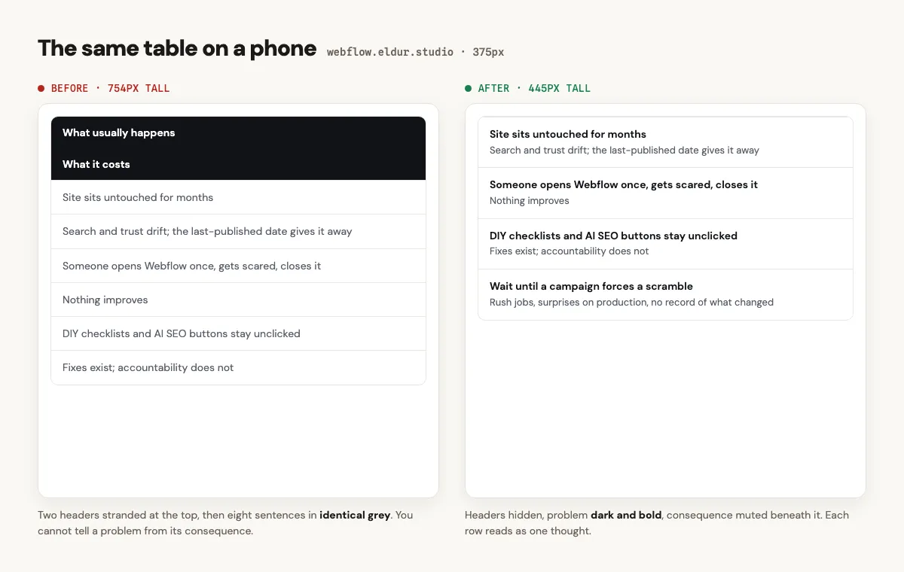

We are about to start sending free Webflow audits to strangers. That felt like a bad moment to have never run one on ourselves.

As we roll out our first self-service agent, [Watchtower](http://webflow.eldur.studio/), of course we tried some dofooding! Before the first outreach email went out, we pointed Watchtower at [**webflow.eldur.studio**](http://webflow.eldur.studio/): our own site, the one selling the maintenance service. A public-site scan, then a report in the inbox. A free prospect audit does not need Webflow guest access.

Note I had _just_ updated the landing page, and manually QA’d everything.

It flagged five things for review.

## The setup

Watchtower is the maintenance agent we built for Webflow sites that nobody is really looking after. It scans weekly, fixes what it safely can on staging, and waits for your approval before anything reaches production.

Our internal serviceability score came back **Green+ (yay!)**. That describes which kinds of changes we can prepare safely on this site. It does not mean the site has no problems, or replace a review of the findings.

Then I read the findings.

## What it found

**1. Our Webflow Certified Partner badge had no alt text.**

The badge sits on the homepage doing exactly one job: proving we are a real Webflow partner. A screen reader did not receive a text description of that meaningful image. A visible badge alone was not enough.

**2. Twenty-eight of sixty-six images had no alt text.**

Including brand assets uploaded that same week, by me, while building the very page that sells this service. Noted that Webflow flags this automatically, but I’m tuned to ignore it since the alert is minuscule.

**3. A template style guide page was public and sitting in our sitemap.**

Leftover furniture from the original Webflow template. Five H1s on it. Search engines were free to index it alongside the pages we actually care about.

**4. The subscribe and thank-you pages had no social preview image.**

Anyone sharing our checkout link in Slack or LinkedIn got a blank grey card. That made the links less useful to share.

**5. The "see an example" link opened a raw PNG on a CDN.**

It worked. It was also untrackable and landed badly on a phone.

## What was not broken

 No 404s. No critical broken links. These findings did not come from customer reports.

That is the whole point. Site neglect almost never announces itself. It accumulates as small invisible losses: the alt text nobody wrote, the template page nobody removed, the preview image nobody set. These small tasks are easy to postpone when nobody owns the maintenance list.

A site can be **Green+ and still be quietly leaking credibility.** This is one scan of our own site, not evidence about every neglected Webflow site.

## The bug we found by accident

While fixing the findings, I opened the site on a phone and hit something the audit does not check for.

We have two comparison tables ("what usually happens" against "what it costs"). On desktop they read fine. On mobile they collapse to a single column, which someone had already set up correctly. But the styling never adapted to the collapse. The two dark column headers ended up stacked on top of each other with nothing beneath them, and all eight cells rendered in identical grey at identical weight.

The result was a list of eight anonymous sentences. You could not tell which line was the problem and which was the consequence. The information was all there and the meaning was gone.

Fixing it took one CSS rule per table: hide the orphaned headers on small screens, make the problem line dark and semibold, leave the consequence muted underneath. Each row now reads as one thought. The revised layout was shorter and easier to read.

Worth saying plainly: **our automated scan did not catch this.** Nothing was missing or broken, so no check fired. It took a human opening the page on a phone. That is a real limit of what weekly automation does, and pretending otherwise would be selling something we do not have.

## What we changed

We addressed four areas that week:

- Alt text written for fourteen meaningful images, starting with that badge. Genuinely decorative icons kept empty alt, which is correct, not lazy.
- Social preview images set on the subscribe and thank-you pages.
- The raw PNG link replaced with a small button that opens the sample report in a modal, with a hover preview on desktop and a click event we can measure. A click does not tell us whether someone requested an audit or subscribed.
- Mobile tables rebuilt as problem-and-consequence pairs.

The style guide page is still on the list.

## Why we are publishing the unflattering version

We could have run this audit, quietly fixed everything, and written a post about how thorough our process is.

The honest version is more useful to anyone deciding whether this service is worth paying for. It tells you what the audit actually catches (metadata, links, scripts, structure), what it misses (a layout that is technically fine and practically unreadable), and what a realistic result looks like on a site that is already in decent shape.

If you want the same scan on your site, the audit is free and the findings are yours regardless of whether you subscribe. The public URL is enough for the free audit. If you subscribe, we arrange the access needed to prepare fixes on staging; changes require your approval before production.

Watchtower supports Webflow only. The service is $299/month and includes two custom changes monthly, alongside the recurring checks and staging-first workflow.

[Get your free site audit](https://webflow.eldur.studio/)

